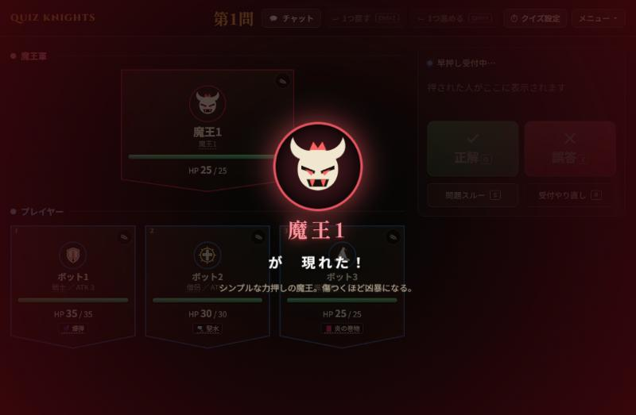
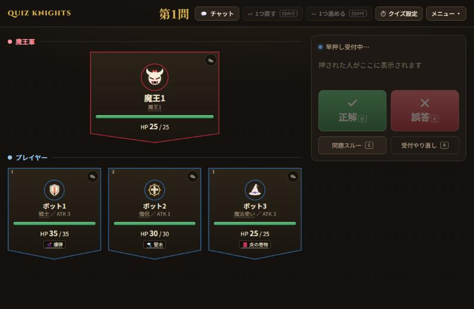
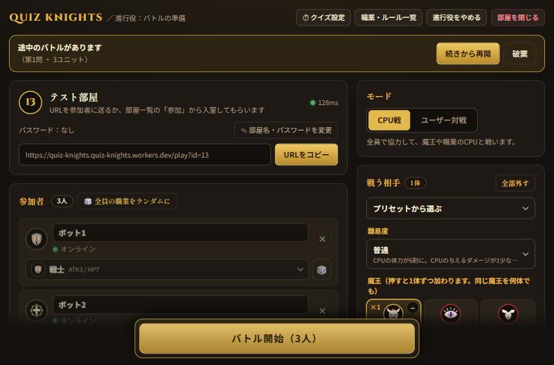
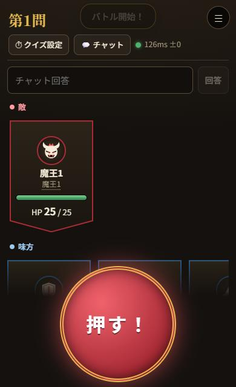

# QUIZ KNIGHTS（クイズ騎士団）

**早押しクイズが、みんなで挑むRPGバトルになる。** https://quiz-knights.quiz-knights.workers.dev

問題の読み上げと正誤の判定は、進行役（人間）が担当します。早押しで勝って正解した人が、自分の職業の技で戦います。ブラウザだけで遊べて、スマホにも対応しています。

- 職業25種・魔王6体・アイテム30種。魔王や職業のCPUと協力して戦う「CPU戦」と、最大3チームの「ユーザー対戦」
- サーバーが時刻をそろえて早押しを判定するので、遠隔でも公平。途中参加・退室OK。進行役が落ちても、ほかの人が引き継げます
- 1試合は約20問。通話アプリと一緒に遊ぶ前提で、音声機能はありません

| 魔王の登場 | バトル中（進行役） |
|---|---|
|  |  |

| 進行役の準備 | スマホの早押し |
|---|---|
|  |  |

紹介文の全文は [docs/INTRO.md](docs/INTRO.md)。アプリ内の紹介ページは `/about` です。
技術構成の整理は [docs/ARCHITECTURE.md](docs/ARCHITECTURE.md) にあります。

## 構成
```
app/                フロント（Svelte 5 + Vite）
  src/lib/engine/   ゲームのルール（画面に依存しない）… data / context / jobs / items / ai / battle
  src/lib/engine.js ルールの入口（ここから import する）
  src/lib/stores/   画面の状態クラス … host（進行役）/ play（参加者）/ ui（トースト・ダイアログ）/ sound
  src/lib/          通信 net・名簿 roster・配信 publish・裁定 rulings など、画面に依存しない部品
  src/components/   共通の部品（Unit・Modal・RulesDialog など）
  src/pages/        部屋一覧 List / 進行役 Host（準備・バトル）/ 参加者 Play
  src/theme.css     共通デザイン（金=主操作、緑=正解・回復、赤=誤答・敵、青=味方）
server/             サーバー（Cloudflare Workers + Durable Objects）
  worker.js         入口（/api と /ws）
  room.js           部屋ごとの Durable Object（早押しの判定・選択の中継・進行役の引き継ぎ）
  buzz.js           早押しの判定（押下時刻＋ディレイ、同時押しの許容）
  lobby.js / config.js  部屋一覧・定数
test/               自動テスト（種類ごとに分けています）
  engine/           ルール: 個別・総当たり・ランダム戦闘・アイテム・裏技・裁定・ゴールデン
  server/           サーバー: 早押し・部屋・引き継ぎ（wrangler を起動して通信まで確かめます）
  client/           画面の状態・通信・名簿などの部品
  static.test.mjs   コンパイル・import・孤立ファイル・未使用 import の検査
scripts/            補助スクリプト（ゴールデンの更新）
dist/               ビルド結果（Git 管理外）。Workers Assets で配信
```

## 開発
```
npm install
npm test              # 自動テスト（ルール・全分岐・ランダム戦闘・サーバー。約180件）
npm run build         # app/ → dist/
npm run worker        # http://localhost:8787 （ビルド済みの dist を配信）
npm run dev           # Vite 開発サーバー（:5173、/api と /ws は :8787 にプロキシ）
```
`npm run dev` を使うときは、別のターミナルで `npm run worker` も起動してください。

## 公開（Cloudflare 無料プラン）
```
npx wrangler login
npm run deploy        # ビルドしてデプロイ
```
`main` への push で自動デプロイしたい場合は、GitHub の Secrets に
`CLOUDFLARE_API_TOKEN` と `CLOUDFLARE_ACCOUNT_ID` を登録してください（`.github/workflows/deploy.yml`）。
動作確認用に別名で公開するなら `npx wrangler deploy --name quiz-knights-dev`。

## 早押し判定
- 各端末が時計ずれを補正した押下時刻を送信し、サーバーが `押下時刻 + ディレイ` の最小の人を勝者にします。
- 通信遅延の許容は、押した人の遅延から自動で決まります（`server/config.js` の `TOLERANCE_MIN_MS` 〜 `TOLERANCE_MAX_MS`）。
- バーサーカーは +700ms（`app/src/lib/engine.js` の `BERSERKER_DELAY_MS`）。

## 部屋
- 1〜16番の固定枠。進行役が30分不在だと自動で閉じます。
- 進行役を別の画面で開くと、後から開いた画面が引き継ぎ、前の画面は停止します。

## テストの種類

- `npm test` — すべてのテスト（約4万件、1分弱）
- **ゴールデンテスト**（`test/engine/golden.test.mjs`）… 決まった乱数で戦闘を最後まで進め、結果を `test/engine/golden/engine.json` と比べます。リファクタリングで挙動が変わると失敗します。意図して挙動を変えたときだけ `npm run test:update-golden` で保存し直します。
- **画面の状態クラス**（`test/client/stores.test.mjs`）… 参加者の `PlayStore` と進行役の `HostStore` を、偽のサーバー・偽の保存領域で動かし、受け取ったメッセージでの状態の変化と、送るメッセージを確かめます（Vite でルーン付きの `.svelte.js` を読み込みます）。
- **アイテム・裁定**（`items*.test.mjs`・`rulings.test.mjs`）… アイテムの効果・乱戦・全職業×全アイテムと、ルール画面の裁定がエンジンの動きと合っているかを確かめます。
- **静的検査**（`test/static.test.mjs`）… すべての Svelte がコンパイルでき、import の行き先と名前が存在し、孤立したファイルがないことを確かめます。
- **組み合わせテスト**（`matrix.*.test.mjs`）… 職業×職業、魔王×難易度×人数、ランダム戦闘などを1ケース1テストで流します。
- **サーバーのテスト**（`test/server/server.test.mjs`）… `wrangler dev` を起動して、実際の部屋・早押し・チャットを検証します。
